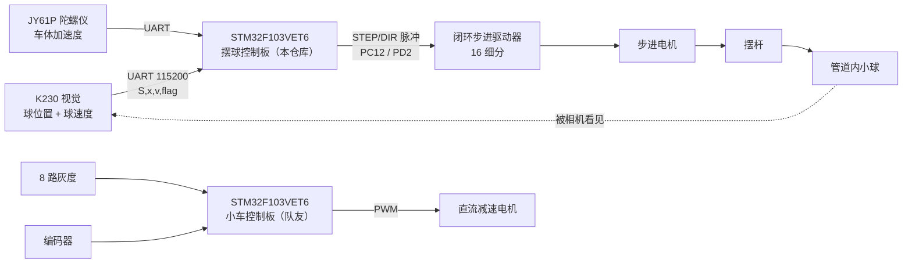

# 车载平衡滚球运动系统 · 摆球控制板固件

2026 年全国大学生电子设计竞赛 H 题（车载平衡滚球运动系统）的**摆球控制板**固件。

小车在跑、管道在晃，管道里的球要稳住。系统由两块 MCU 分工：**一块管车**（循迹、定距、停车），**一块管球**（视觉读位置、算倾角、发脉冲）。本仓库是**管球的那一块**。

> **我的分工**：摆球板固件（本仓库全部代码）、驱动板硬件设计（原理图 + 双层 PCB）、步进电机与 PID 参数整定。
> 小车控制板与 K230 视觉识别由队友实现，本仓库不含其源码。

---

## 系统架构



闭环是这样转的：**相机看见球 → 算出球偏离目标多少 → 换算成摆杆该倾斜多少 → 发脉冲让电机把杆转过去 → 球滚动 → 再被看见**。所有代码都在服务这一圈。

一个关键取舍：**杆角是开环的，球位是闭环的**。摆杆没有角度传感器，靠软件累计脉冲数估算转角；球的位置由视觉闭环。所以代码里所有"角度"都是脉冲换算出来的估计值，丢步就会失真——这也是软件限位必须存在的理由。

---

## 控制周期：10 ms

整机只有一个节拍：`TIM1` 更新中断，**100 Hz**（`ARR=999, PSC=719`，72 MHz/720/1000）。

```c
void TIM1_UP_IRQHandler(void)
{
    Key_Tick();              // 按键消抖
    Encoder_Read();          // 编码器
    Read_Track_DATA();       // 灰度
    Track_Control();         // 循迹
    Balance_Control();       // 摆球：视觉误差 + 前馈 → 步进电机
}
```

中断里只做"算一次控制量、发一批脉冲"，**不发字符串、不阻塞**。视觉数据由 UART4 接收中断写入共享变量，主循环只负责 OLED 显示和模式切换。

选 10 ms 的理由：K230 出帧约 30 fps（33 ms），控制周期再快也拿不到新数据；再慢则球已经跑偏。

---

## 控制算法

每 10 ms 算一次摆杆目标倾角 θ，再换成脉冲发出去：

```
θ = Kp·e + Kd·ė          # 位置 PD
  + 速度阻尼前馈 (−Kv·v)
  + 加速度前馈 (kff·Ax)   # 车在加减速，球会被惯性甩走
  + 卡滞补偿偏置          # 球卡住时"多给一点"
  + 最低锁定坡度          # 克服静摩擦的最小倾角
```

| 模块 | 作用 | 关键参数 |
|---|---|---|
| 位置 PD | 误差 e = 目标 − 球位置 | 主回路 |
| 速度阻尼前馈 | 球快了提前反向压，抑制超调 | `KV=0.02`；球速 <3 cm/s 时关闭（噪声） |
| 加速度前馈 | 车加减速时抵消惯性 | 按目标距离分 5 档增益 |
| 卡滞补偿 | 球不动时逐步加偏置，动起来再退 | 15 拍（150 ms）触发，最大 0.055 rad |
| 最低锁定坡度 | 静摩擦死区 | 叠加在最终倾角上 |
| 软件限位 | 无位置反馈下的安全边界 | `±300` 脉冲 ≈ ±34°，`THETA_MAX=0.08 rad` |

**脉冲换算**：`3200 脉冲/圈`（1.8° 步距角 × 16 细分）→ `PULSES_PER_RAD ≈ 509 脉冲/rad`。
每个 10 ms 周期最多发 `32` 个脉冲（≈ 0.063 rad/拍），这个上限就是"杆的最大角速度"，防止一冲动把球甩出去。

---

## 硬件与踩过的坑

### 1. 光耦输入必须共地（最痛的一个）

步进驱动器的 `PUL/DIR` 是**光耦隔离输入**（`PUL+ / PUL− / DIR+ / DIR−`）。光耦是一次"发光—受光"，**必须形成完整电流回路**：

- 共阳接法：`PUL+`、`DIR+` 接 5V，`PUL−`/`DIR−` 接 MCU 引脚 → **MCU 的 GND 必须和驱动器 GND 连在一起**，否则电流没有回路，光耦不导通，脉冲全丢。
- 共阴接法同理，方向反过来。

一开始 STM32 和驱动器分别接在 DC-DC 模块的两个接地端子上，看似"都接地了"，实际路径不对：自检模式能动，正常控制不动。把两处地改到 PCB 同一个接地点后恢复正常。

**信号地和功率地要分开走、单点汇合**：功率地走 1~3 A 的电机电流，信号地只有 mA 级，混在一起电机一动就把逻辑地抬起来。

### 2. 脉冲丢失与软件限位

`step.c` 里发脉冲用的是软件延时 + GPIO 翻转：

```c
GPIO_SetBits(PUL);  StepPulse_Delay();  GPIO_ResetBits(PUL);  StepPulse_Delay();
```

好处是简单、周期内脉冲数可控；代价是**发脉冲期间 CPU 被占住**。一发 32 个脉冲约 0.5~1 ms，占掉 10 ms 周期的 5~10%。UART4 接收中断优先级高于 TIM1，能打断它——字节不会丢（只写共享变量），但这一拍脉冲会被拉长，实际转速略低于设定值。

更彻底的做法是定时器输出比较 / PWM 发脉冲、DMA 搬频率序列做加减速；本项目为了调试直观选了软件脉冲，并用 `STEP_PULSE_ABS_LIMIT` 兜底——**开环发脉冲最怕"以为转了，其实没转"**。

### 3. 卡滞补偿

静摩擦让球"抬一点不动、再抬就冲出去"。代码里用状态机处理：误差大于死区、球速接近 0、连续 15 拍没进展 → 每拍加 `0.007 rad` 偏置；球一动（>1.5 cm/s）就按 `0.001 rad/拍` 退回去。补偿上限 `0.055 rad`，再大就会过冲。

---

## 关键数字

| 项 | 值 |
|---|---|
| 控制周期 | 10 ms（100 Hz） |
| 步进细分 | 16（3200 脉冲/圈） |
| 角度分辨率 | 0.1125°/脉冲 ≈ 509 脉冲/rad |
| 每拍最大脉冲 | 32（≈ 0.063 rad） |
| 软件限位 | ±300 脉冲（≈ ±34°） |
| 摆杆最大倾角 | 0.08 rad（≈ 4.6°） |
| 视觉帧率 | ~30 fps，UART 115200 |
| 串口帧 | `S,x,v,flag\n`（球位置 / 球速度） |

---

## 目录结构

```
User/           main.c（主循环 + TIM1 中断）、中断向量
Hardware/       Balance（控制核心）、step（脉冲）、K230（视觉）、
                PID、usart、Encoder、Motor、Track、OLED、Key
System/         delay、sys（时钟 / GPIO 初始化）
Library/        STM32F10x 标准外设库
Start/          启动文件与 CMSIS
Track/          循迹传感器
docs/           设计说明（协议、引脚表、算法推导、调参指南）
Project.uvprojx Keil MDK 工程
```

## 编译

Keil MDK 5 + ARM Compiler 5，打开 `Project.uvprojx` 直接编译（0 error / 0 warning）。目标芯片 STM32F103VET6，标准外设库（非 HAL）。

## 已知不足

- 杆角靠脉冲累计估计，丢步后需重新回零；
- 软件脉冲发放在中断内占用 CPU，未做加减速曲线；
- 摆球板与小车板之间没有硬连线握手，靠操作手同时按键启动（第二版应加 GPIO 同步信号）；
- 卡滞补偿参数是手调的，不同管道摩擦差异大。
